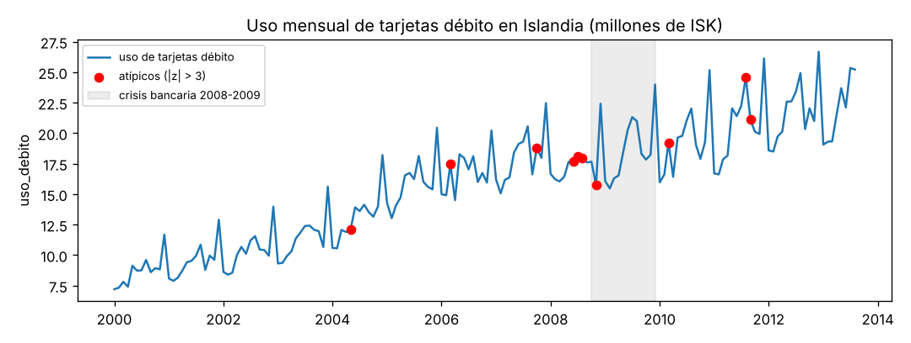
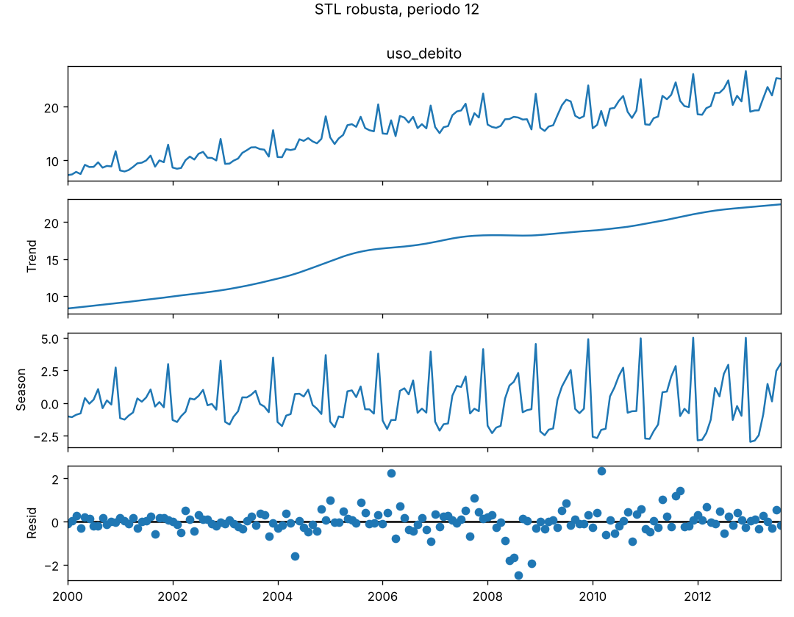
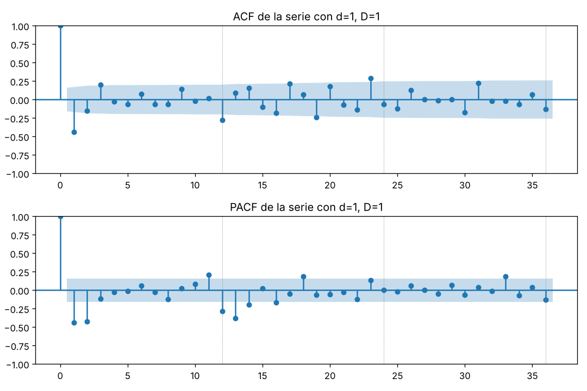
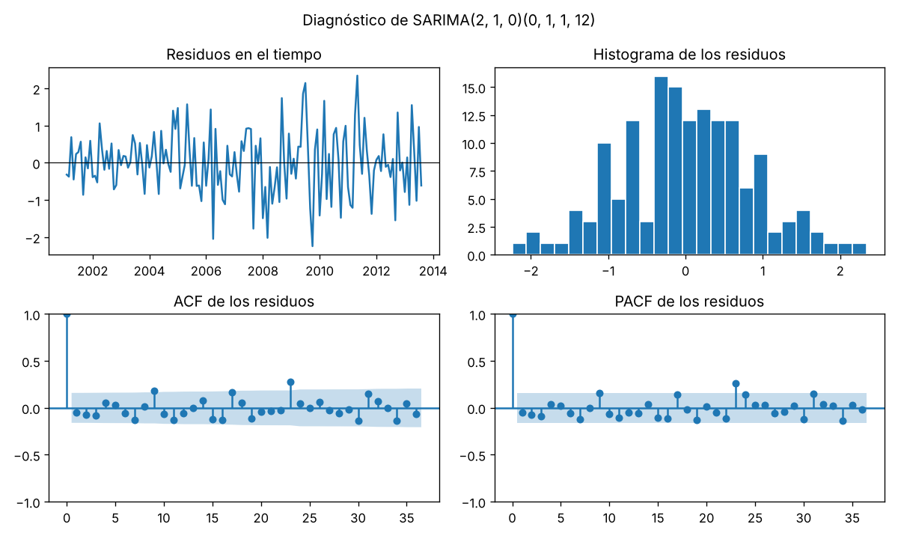
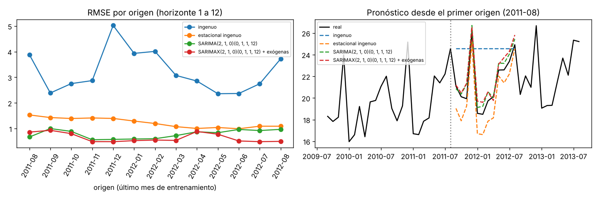

# Informe del miniproyecto 1

**Serie:** uso mensual de tarjetas débito en Islandia, 2000-01 a 2013-08.
Todas las cifras de este informe salen de lo que imprime
`python miniproyecto.py`, y las figuras son las que ese guion deja en
`figuras/`. Las tablas completas quedan en `resultados/`.

## 1. La serie

La serie mide el **valor mensual de las compras con tarjeta débito en el
comercio minorista de Islandia**, en millones de coronas islandesas (ISK) a
precios corrientes. La publica Statistics Iceland (Hagstofa Íslands) con
licencia **CC BY 4.0**, y la tomamos de la copia del paquete de R `fpp2`
(conjunto `debitcards`) que publica en CSV el repositorio Rdatasets (licencia
GPL-3). Es **mensual**, va de **enero de 2000 a agosto de 2013** y tiene
**164 observaciones**, más que las 60 que pide el enunciado: en el primer
origen del backtest quedan 140 meses para ajustar. La ficha completa está en
[`datos/README.md`](../datos/README.md).

La elegimos por tres razones: (1) tiene una **estacionalidad muy visible**
(diciembre siempre es el pico, por las compras navideñas); (2) depende del
**calendario**, porque las compras con tarjeta dependen de cuántos días
hábiles tiene el mes, y eso da una variable exógena natural que se conoce de
antemano para el SARIMAX; y (3) atraviesa la **crisis bancaria islandesa de
2008**, un choque real que obliga a tomar una decisión sobre los atípicos.

La serie sube de 7.204 (2000-01, el mínimo) a 26.675 (2012-12, el máximo), con
media 15.828. Además del crecimiento, se ve que **la amplitud del ciclo anual
crece con el nivel**: los picos de diciembre son cada vez más altos con
respecto al resto del año.

**Huecos.** La serie no tiene meses vacíos (el guion imprime `0 vacíos`). Aun
así, `preparar` aplica la regla del grupo: si un mes viniera vacío se
rellenaría por **interpolación lineal en el tiempo** entre sus vecinos, que
para una serie con tendencia es menos dañino que repetir el último valor.

**Datos atípicos.** Para detectarlos ajustamos una STL robusta y tomamos su
residuo $R_t$. Un mes es atípico si

$$
|z_t| = \frac{|R_t - \operatorname{mediana}(R)|}{1.4826\,\operatorname{MAD}(R)} > 3,
$$

donde $1.4826\,\operatorname{MAD}$ es una desviación estándar robusta (no se
infla con los mismos atípicos). El guion encuentra **10 meses**:

| Mes | Valor | Residuo STL | $z$ | Días hábiles (promedio del mes) |
|---|---|---|---|---|
| 2004-05 | 12.077 | −1.599 | −4.6 | 19 (20.2) |
| 2006-03 | 17.459 | +2.236 | +6.4 | 23 (21.4) |
| 2007-10 | 18.788 | +1.083 | +3.1 | 23 (22.2) |
| 2008-06 | 17.705 | −1.816 | −5.2 | 20 (20.1) |
| 2008-07 | 18.107 | −1.686 | −4.9 | 23 (22.1) |
| 2008-08 | 17.975 | −2.490 | −7.2 | 20 (21.3) |
| 2008-11 | 15.750 | −1.950 | −5.6 | 20 (21.5) |
| 2010-03 | 19.216 | +2.336 | +6.7 | 23 (21.4) |
| 2011-08 | 24.565 | +1.195 | +3.4 | 22 (21.3) |
| 2011-09 | 21.095 | +1.430 | +4.1 | 22 (21.3) |

Los atípicos se explican por dos causas reales:

- **La crisis de 2008** (junio, julio, agosto y noviembre de 2008, todos
  negativos): la corona se devaluó en el primer semestre y los tres grandes
  bancos quebraron en octubre de 2008.
- **El calendario:** los atípicos positivos de 2006-03, 2007-10 y 2010-03
  tienen 23 días hábiles, uno o dos más que el promedio de ese mes, y el
  negativo de 2004-05 tiene 19, uno menos. La Semana Santa cae a veces en
  marzo y a veces en abril, y eso cambia los días hábiles de marzo.

**Decisión:** *huecos por interpolación lineal (la serie no trae ninguno);
los atípicos se conservan sin cambios*. No son errores de captura sino meses
que ocurrieron, y el backtest debe medir los modelos con los datos tal como
ocurrieron. Si los suavizáramos, el backtest se vería mejor de lo que el
modelo es en realidad. En vez de borrar el efecto del calendario, lo
modelamos con la exógena del SARIMAX (sección 5). Esta frase es la columna
`decision` de la tabla de métricas.

## 2. Componentes

Usamos STL robusta con periodo $m = 12$, que separa la serie en forma
aditiva:

$$
y_t = T_t + S_t + R_t .
$$

La opción robusta les da menos peso a los meses atípicos al estimar $T_t$ y
$S_t$, de modo que la crisis de 2008 queda en el residuo y no deforma la
tendencia ni la estacional.

**Tendencia.** Pasa de 8.32 (2000-01) a 22.39 (2013-08): se multiplica por
2.69. El crecimiento tiene tres tramos claros (promedio anual compuesto de la
tendencia):

| Tramo | Crecimiento anual |
|---|---|
| 2000–2007 (auge del crédito) | 10.9 % |
| 2007–2010 (crisis) | 2.5 % |
| 2010–2013 (recuperación) | 5.0 % |

El año de mayor crecimiento fue 2005 (17.5 %) y los más bajos 2008 y 2009
(1.9 % cada uno). En la crisis la tendencia **se aplana pero no cae**: la
serie está en coronas corrientes, y la inflación de esos años (la corona
perdió buena parte de su valor) sostuvo el valor nominal de las compras aunque
el consumo real cayera.

**Estacional.** Promedio del componente estacional por mes:

| ene | feb | mar | abr | may | jun | jul | ago | sep | oct | nov | dic |
|---|---|---|---|---|---|---|---|---|---|---|---|
| −1.84 | −2.09 | −1.56 | −1.23 | +0.65 | +0.72 | +1.21 | +1.88 | −0.57 | −0.35 | −0.62 | **+4.02** |

**Diciembre** es el mes más alto (+4.02 por encima de la tendencia, por la
Navidad) y **febrero** el más bajo (−2.09). Enero a abril quedan por debajo y
mayo a agosto por encima (verano, temporada turística). La **amplitud
estacional** (máximo menos mínimo en el año) se duplica: 3.80 en 2000 y 7.86
en 2012. Eso indica una estacionalidad más bien **multiplicativa**: crece con
el nivel. Lo tenemos en cuenta en el diagnóstico de los residuos.

**Residuo.** Su desviación estándar es 0.569. El residuo más grande es el de
**2008-08 (−2.49)**, en plena crisis, y los residuos negativos de 2008 forman
un grupo visible en el panel inferior de la figura. Las fuerzas de la
tendencia y de la estacionalidad,
$F_T = \max\!\left(0, 1 - \frac{\operatorname{Var}(R_t)}{\operatorname{Var}(T_t + R_t)}\right) = 0.984$
y
$F_S = \max\!\left(0, 1 - \frac{\operatorname{Var}(R_t)}{\operatorname{Var}(S_t + R_t)}\right) = 0.903$,
confirman que las dos son fuertes.

## 3. Líneas base y backtest

**El backtest común** (`comun.backtest`, que no se modificó) usa **origen
móvil sobre los últimos 24 meses** con **horizonte de 1 a 12**. Con
$n = 164$, el primer origen es el mes $n - 24 = 140$ y el último es el
$n - 12 = 152$, así que hay **13 orígenes**: de **2011-08 a 2012-08** (el
último mes que ve el modelo). Los meses que se pronostican van de
**2011-09 a 2013-08**. En cada origen el modelo pronostica los 12 meses
siguientes y se calculan

$$
\text{RMSE} = \sqrt{\frac{1}{h}\sum_{k=1}^{h}(y_{t+k} - \hat y_{t+k})^2},\qquad
\text{MAE} = \frac{1}{h}\sum_{k=1}^{h}|y_{t+k} - \hat y_{t+k}|,\qquad
\text{MAPE} = \frac{100}{h}\sum_{k=1}^{h}\left|\frac{y_{t+k} - \hat y_{t+k}}{y_{t+k}}\right|,
$$

con $h = 12$. Las cifras de la tabla son el promedio de los 13 orígenes.

**Por qué no hay fuga de información.** En cada origen, `backtest` corta
`serie.iloc[:corte]` y solo eso le pasa a `modelo(entrenamiento, h)`. Los
modelos se **vuelven a estimar en cada origen** con esos datos, de modo que ni
los coeficientes ni el orden de diferenciación ven los 12 meses que se van a
medir. La exógena del SARIMAX es el número de días hábiles, que sale del
calendario y no de los datos (sección 5).

Las dos líneas base son

$$
\text{ingenuo: } \hat y_{t+k} = y_t, \qquad
\text{estacional ingenuo: } \hat y_{t+k} = y_{t+k-12\lceil k/12\rceil}.
$$

| Modelo | RMSE | MAE | MAPE (%) |
|---|---|---|---|
| ingenuo | 3.23 | 2.69 | 12.31 |
| estacional ingenuo | **1.23** | **1.10** | **5.17** |

**Gana el estacional ingenuo**, con menos de la mitad del error del ingenuo
en las tres métricas. Es lo esperado en una serie con estacionalidad tan
fuerte: el ingenuo repite el último mes durante un año entero y falla de lleno
en los picos de diciembre (su peor origen es 2011-12, con RMSE 5.02, porque
repite el pico de diciembre durante los 12 meses siguientes). El estacional
ingenuo copia el patrón del año anterior, pero no le suma el crecimiento: por
eso se queda corto, como se ve en la figura del backtest de la sección 6.

## 4. Estacionariedad e identificación

Usamos la prueba de Dickey-Fuller aumentada (ADF), que estima

$$
\Delta y_t = \alpha + \beta t + \gamma\, y_{t-1} + \sum_{i=1}^{k}\delta_i\,\Delta y_{t-i} + \varepsilon_t,
$$

con $H_0: \gamma = 0$ (raíz unitaria, no estacionaria) frente a
$H_1: \gamma < 0$. El número de rezagos $k$ lo elige el AIC. La
especificación (`regression`) depende de lo que muestra cada versión:
`ct` ($\alpha$ y $\beta$) si hay tendencia, `c` (solo $\alpha$) si no hay
tendencia pero el nivel puede no ser cero, y `n` (ni $\alpha$ ni $\beta$) si la
serie oscila alrededor de cero. Con $B$ el operador de rezago, la diferencia
regular es $(1 - B)y_t = y_t - y_{t-1}$ y la estacional
$(1 - B^{12})y_t = y_t - y_{t-12}$.

| Versión | `regression` elegida | $p$ (`n`) | $p$ (`c`) | $p$ (`ct`) | $p$ elegido |
|---|---|---|---|---|---|
| original ($d=0, D=0$) | `ct` (hay tendencia) | 0.9825 | 0.7276 | 0.5980 | 0.5980 |
| regular ($d=1, D=0$) | `c` | 0.0542 | 0.0330 | 0.1112 | 0.0330 |
| estacional ($d=0, D=1$) | `c` | 0.3246 | 0.2902 | 0.4789 | 0.2902 |
| las dos ($d=1, D=1$) | `n` (media cero) | 0.0000 | 0.0000 | 0.0000 | **0.0000** |

(Tabla completa en `resultados/adf.csv`.)

**Elección de $D$.** La ADF solo mira la raíz unitaria regular. Que la
diferencia regular sola pase la prueba ($p = 0.0330$, apenas por debajo de
0.05) no quiere decir que la estacionalidad se haya ido: la ACF de la serie
con solo $d = 1$ vale **0.821, 0.716 y 0.619 en los rezagos 12, 24 y 36**, un
decaimiento lentísimo que es la huella de una raíz unitaria estacional. Por
eso tomamos **$D = 1$**.

**Elección de $d$.** Con $D = 1$ y $d = 0$ la ADF **no rechaza** la raíz
unitaria ($p = 0.2902 \geq 0.05$): la diferencia estacional sola deja una serie
que todavía deriva, por la tendencia que cambia de ritmo (auge, crisis,
recuperación). Con **$d = 1$ y $D = 1$** el valor $p$ es $0.0000 < 0.05$ en las
tres especificaciones. Elegimos **$d = 1$, $D = 1$**:

$$
w_t = (1 - B)(1 - B^{12})\,y_t .
$$

La serie $w_t$ tiene 151 observaciones y la banda de 95 % es
$\pm 1.96/\sqrt{151} = \pm 0.160$.

- **ACF fuera de la banda:** rezagos 1 (−0.439), 3 (0.202), **12 (−0.277)**,
  16 (−0.179), 17 (0.219), 19 (−0.238), 20 (0.177), 23 (0.288), 30 (−0.171) y
  31 (0.223).
- **PACF fuera de la banda:** rezagos **1 (−0.439), 2 (−0.425)**, 11 (0.207),
  **12 (−0.285), 13 (−0.379), 14 (−0.198)**, 16 (−0.164), 18 (0.187) y 33
  (0.19).

**Órdenes que sugieren.**

- **Parte regular:** la PACF tiene dos picos grandes en 1 y 2 y después cae a
  valores pequeños, el patrón de un **AR(2)** ($p = 2$, $q = 0$). La ACF
  también se puede leer como un pico en 1 que se corta, que sería un MA(1)
  ($p = 0$, $q = 1$). Las dos lecturas entran a la rejilla.
- **Parte estacional:** la ACF tiene un pico negativo en 12 y nada
  significativo en 24 ni en 36 (se corta), y la PACF decae en 12, 13 y 14.
  Es la firma de un **MA estacional de orden 1** ($P = 0$, $Q = 1$), típica
  después de una diferencia estacional.
- Los picos sueltos en 17, 19, 23 y 31 no siguen un patrón estacional y no los
  modelamos; al ser 10 de 36 rezagos, más de los que se esperarían por azar,
  sugieren que quedará algo de estructura en los residuos (sección 5).

Candidatos iniciales: SARIMA$(2,1,0)(0,1,1)_{12}$ y SARIMA$(0,1,1)(0,1,1)_{12}$
(el "modelo de aerolínea").

## 5. Modelos clásicos

**Rejilla.** Con $d = 1$ y $D = 1$ fijos, ajustamos con toda la serie los
$3 \times 3 \times 2 \times 2 = 36$ modelos con $p, q \in \{0, 1, 2\}$ y
$P, Q \in \{0, 1\}$, y los comparamos por

$$
\text{AIC} = -2\ln \hat L + 2k, \qquad \text{BIC} = -2\ln \hat L + k\ln n,
$$

con $k$ el número de parámetros. Los 10 de menor AIC (la rejilla completa
está en `resultados/rejilla_aic.csv`):

| $p$ | $q$ | $P$ | $Q$ | Parámetros | AIC | BIC | $\Delta$AIC |
|---|---|---|---|---|---|---|---|
| **2** | **0** | **0** | **1** | **3** | **389.95** | **402.02** | **0.00** |
| 2 | 1 | 0 | 1 | 4 | 390.31 | 405.40 | 0.36 |
| 2 | 0 | 1 | 1 | 4 | 391.41 | 406.49 | 1.46 |
| 2 | 1 | 1 | 1 | 5 | 391.83 | 409.94 | 1.89 |
| 2 | 2 | 0 | 1 | 5 | 391.95 | 410.05 | 2.00 |
| 2 | 2 | 1 | 1 | 6 | 393.41 | 414.53 | 3.46 |
| 0 | 2 | 0 | 1 | 3 | 394.09 | 406.16 | 4.14 |
| 2 | 1 | 1 | 0 | 4 | 394.18 | 409.26 | 4.23 |
| 0 | 1 | 0 | 1 | 2 | 394.73 | 403.78 | 4.78 |
| 2 | 0 | 1 | 0 | 3 | 394.73 | 406.80 | 4.79 |

**Regla de elección.** Tomamos el menor AIC; si hay modelos a menos de 2
puntos de AIC (diferencia que no se considera significativa), nos quedamos con
el de menor BIC entre ellos, porque el BIC castiga más los parámetros
(parsimonia). Hay 5 modelos a menos de 2 puntos, y el de menor BIC es también
el de menor AIC: **SARIMA$(2,1,0)(0,1,1)_{12}$**, con AIC = 389.95 y
BIC = 402.02. Coincide con lo que sugerían la ACF y la PACF. Los 7 primeros
tienen $Q = 1$, lo que confirma el MA estacional. El modelo de aerolínea
$(0,1,1)(0,1,1)_{12}$ queda noveno ($\Delta$AIC = 4.78).

**El modelo elegido.** Con la convención de `statsmodels`:

$$
(1 - \phi_1 B - \phi_2 B^2)(1 - B)(1 - B^{12})\,y_t = (1 + \Theta_1 B^{12})\,\varepsilon_t,
\qquad \varepsilon_t \sim \text{RB}(0, \sigma^2),
$$

| Parámetro | Estimación | Error estándar | $p$ |
|---|---|---|---|
| $\phi_1$ (`ar.L1`) | −0.7068 | 0.0702 | 0.0000 |
| $\phi_2$ (`ar.L2`) | −0.4571 | 0.0706 | 0.0000 |
| $\Theta_1$ (`ma.S.L12`) | −0.5296 | 0.0780 | 0.0000 |
| $\sigma^2$ | 0.7122 | 0.0816 | 0.0000 |

Es decir,

$$
w_t = -0.7068\,w_{t-1} - 0.4571\,w_{t-2} + \varepsilon_t - 0.5296\,\varepsilon_{t-12},
\qquad w_t = (1 - B)(1 - B^{12})y_t .
$$

Los tres coeficientes son significativos. Los AR negativos dicen que un mes
que sube más de lo normal tiende a ir seguido de una corrección.

**Diagnóstico de los residuos.** Descartamos los primeros $d + 12D = 13$
residuos (arranque del filtro) y aplicamos Ljung-Box,

$$
Q = n(n+2)\sum_{k=1}^{L}\frac{\hat\rho_k^2}{n-k},
$$

que bajo $H_0$ (residuos sin autocorrelación) sigue una $\chi^2$ con $L - 3$
grados de libertad (descontamos los 3 coeficientes ARMA):

| Rezago $L$ | $Q$ | $p$ |
|---|---|---|
| 12 | 15.13 | **0.0873** |
| 24 | 44.13 | **0.0022** |

- **Hasta el rezago 12** los residuos pasan como ruido blanco ($p = 0.087 > 0.05$):
  el modelo captura la dinámica de corto plazo y la estacional del rezago 12.
- **Hasta el rezago 24 no pasan** ($p = 0.002 < 0.05$). En la ACF de los
  residuos se ve el culpable: un pico de alrededor de 0.28 en el rezago 23, y
  otros menores en 9 y 17. Esto no lo resuelve ningún orden de la rejilla.
- La **media** de los residuos es 0.0050 (prácticamente cero) y su desviación
  estándar 0.8503. En la gráfica se ve que los residuos son **más grandes
  desde 2005**, con el grupo de 2008: la varianza no es constante, lo que
  concuerda con la amplitud estacional que crece (sección 2). El histograma es
  aproximadamente simétrico, con colas algo pesadas por los atípicos.

**Experimento con logaritmos.** Como la estacionalidad crece con el nivel,
probamos el mismo orden sobre $\log y_t$. Ljung-Box mejora ($p = 0.1330$ en 12
y $p = 0.0166$ en 24) pero **sigue sin pasar en 24**, y en el backtest el
modelo en logaritmos es **peor** (RMSE 0.93, MAE 0.75, MAPE 3.50 frente a
0.78, 0.61 y 2.92 en niveles). Nos quedamos con el modelo en niveles. La
lección es que la autocorrelación que queda no se debe solo a la varianza
creciente.

**La variable exógena.** El SARIMAX es una regresión con errores SARIMA:

$$
y_t = \beta\, x_t + u_t, \qquad
(1 - \phi_1 B - \phi_2 B^2)(1 - B)(1 - B^{12})\,u_t = (1 + \Theta_1 B^{12})\,\varepsilon_t,
$$

donde $x_t$ es el **número de días hábiles del mes en Islandia** (lunes a
viernes que no son festivo oficial, según la librería `holidays`; incluye la
Semana Santa, que se mueve entre marzo y abril), centrado en 21. Va de 16 a 23
días.

- **Por qué se conoce de antemano:** sale solo del calendario. Los días
  hábiles de 2014 se sabían desde años antes, así que en cada origen del
  backtest los 12 valores futuros de $x_t$ son conocidos **sin mirar ningún
  dato de la serie posterior al origen**. Por eso no hay fuga: `modelo_sarimax`
  ajusta con `x.loc[entrenamiento.index]` y pronostica con
  `x.loc[fechas_siguientes(entrenamiento, h)]`. Si la exógena no se conociera
  de antemano (por ejemplo, la inflación del mes) habría que pronosticarla
  también, y su error se sumaría al del modelo; usar el valor real sería
  hacer trampa.
- **Resultado:** $\hat\beta = 0.3574$ (error estándar 0.0349,
  $p \approx 10^{-24}$): **cada día hábil adicional suma unos 0.36 millones de
  ISK** al mes, cerca del 1.6 % del nivel de 2013. El AIC con toda la serie
  baja de 389.95 a **331.87** (BIC de 402.02 a 346.96), una mejora de 58
  puntos por un solo parámetro más.
- **En el backtest también mejora** (sección 6): RMSE de 0.78 a 0.64
  (−17.9 %), MAE de 0.61 a 0.54 (−11.5 %) y MAPE de 2.92 a 2.56 (−12.3 %).
- **Lo que no arregla:** Ljung-Box del SARIMAX da $p = 0.0909$ en 12 y
  $p = 0.0069$ en 24, casi igual que el SARIMA. Los días hábiles explican el
  nivel de cada mes, pero no la autocorrelación del rezago 23-24.

## 6. Tabla de métricas

`resultados/metricas.csv`, generada por el guion y ordenada por RMSE (backtest
común, 13 orígenes, horizonte 1 a 12):

| Modelo | Decisión | RMSE | MAE | MAPE (%) |
|---|---|---|---|---|
| SARIMAX$(2,1,0)(0,1,1)_{12}$ + días hábiles | Huecos: interpolación lineal (la serie no trae ninguno); atípicos (residuo STL > 3 MAD) se conservan por ser reales | **0.64** | **0.54** | **2.56** |
| SARIMA$(2,1,0)(0,1,1)_{12}$ | Huecos: interpolación lineal (la serie no trae ninguno); atípicos (residuo STL > 3 MAD) se conservan por ser reales | 0.78 | 0.61 | 2.92 |
| estacional ingenuo | Huecos: interpolación lineal (la serie no trae ninguno); atípicos (residuo STL > 3 MAD) se conservan por ser reales | 1.23 | 1.10 | 5.17 |
| ingenuo | Huecos: interpolación lineal (la serie no trae ninguno); atípicos (residuo STL > 3 MAD) se conservan por ser reales | 3.23 | 2.69 | 12.31 |

RMSE por origen (`resultados/rmse_por_origen.csv`):

| Origen | ingenuo | estacional ingenuo | SARIMA | SARIMAX |
|---|---|---|---|---|
| 2011-08 | 3.88 | 1.53 | **0.67** | 0.86 |
| 2011-09 | 2.39 | 1.43 | 1.00 | **0.93** |
| 2011-10 | 2.75 | 1.39 | 0.89 | **0.80** |
| 2011-11 | 2.87 | 1.41 | 0.56 | **0.49** |
| 2011-12 | 5.02 | 1.39 | 0.58 | **0.49** |
| 2012-01 | 3.93 | 1.29 | 0.59 | **0.53** |
| 2012-02 | 4.01 | 1.20 | 0.60 | **0.55** |
| 2012-03 | 3.07 | 1.07 | 0.72 | **0.54** |
| 2012-04 | 2.85 | 1.00 | **0.87** | 0.89 |
| 2012-05 | 2.36 | 1.04 | 0.84 | **0.78** |
| 2012-06 | 2.37 | 0.99 | 0.96 | **0.52** |
| 2012-07 | 2.75 | 1.09 | 0.92 | **0.49** |
| 2012-08 | 3.72 | 1.09 | 0.97 | **0.50** |

El SARIMAX tiene el menor RMSE en 11 de los 13 orígenes, y los dos modelos
clásicos le ganan al estacional ingenuo en todos. La ventaja del SARIMAX es
más grande en los últimos orígenes (2012-06 a 2012-08), cuyos 12 meses
siguientes tienen meses con muchos días hábiles (2012-10 y 2013-07, con 23)
y con pocos (2012-12 y 2013-03, con 19): justo donde saber el calendario
ayuda.

## 7. Conclusión

El **mejor modelo clásico es el SARIMAX$(2,1,0)(0,1,1)_{12}$ con los días
hábiles del mes como exógena**. Frente a la mejor línea base, el **estacional
ingenuo**, mejora así:

| Métrica | Estacional ingenuo | SARIMAX | Mejora |
|---|---|---|---|
| RMSE | 1.23 | 0.64 | **48.0 %** |
| MAE | 1.10 | 0.54 | **50.9 %** |
| MAPE | 5.17 % | 2.56 % | **50.5 %** |

El error se reduce a la mitad por dos razones: el SARIMA agrega lo que el
estacional ingenuo no tiene, la **tendencia** (con $d = 1$, el pronóstico
sigue subiendo en vez de copiar el año anterior) y una dinámica de corto plazo
(el AR(2)); y la exógena le agrega el **efecto del calendario**, que explica
varios de los meses atípicos de la sección 1.

**Dónde sigue fallando:**

- **Los orígenes 2011-08 a 2011-10** (RMSE de 0.80 a 0.93), cuyos 12 meses
  siguientes incluyen el pico de diciembre de 2011 y los atípicos positivos de
  agosto y septiembre de 2011. En el primer origen (2011-08) el SARIMAX es
  peor que el SARIMA (0.86 frente a 0.67): ahí la exógena no ayudó.
- **El origen 2012-04** (0.89), cuya ventana incluye diciembre de 2012, el
  máximo de toda la serie (26.675).
- **Los residuos no son ruido blanco hasta el rezago 24** (Ljung-Box
  $p = 0.0069$), y su varianza crece con el nivel. Los pronósticos puntuales
  son buenos, pero los intervalos de predicción del modelo probablemente son
  demasiado optimistas.
- La serie termina en 2013-08 y el modelo no tiene cómo anticipar choques como
  el de 2008: un modelo lineal con parámetros fijos solo extrapola el pasado.

Este SARIMAX, con **RMSE 0.64, MAE 0.54 y MAPE 2.56 %**, es el modelo que el
miniproyecto 2 debe superar.
